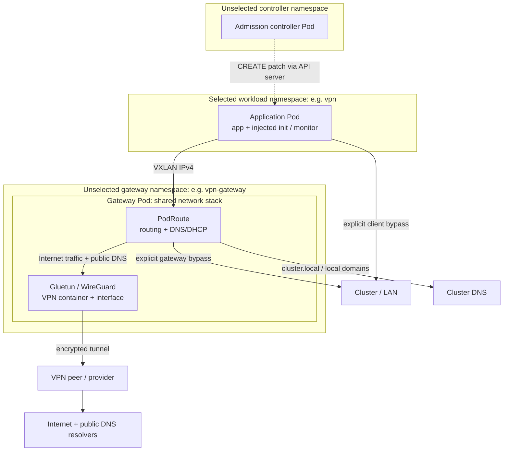

# PodRoute

Route application Pods through a separate VPN gateway Pod. One repository builds two images: `podroute-controller` injects routing helpers; `podroute-gateway` supplies Linux networking and DNS/DHCP. Gluetun or another VPN container owns the tunnel and credentials.

Routing is selected by **Kubernetes namespace**: every new Pod in the configured workload namespaces receives helpers, with no per-Pod opt-out. Other namespaces are unchanged. Keep the gateway in an unselected namespace and the controller outside the selected set too; they need not share a namespace. The webhook's namespace selector must match the controller's configured workload namespaces.

These namespace boundaries group resources; they do not create a shared network stack. Each Pod has its own network namespace, shared by its containers. Application Pods tunnel separately to the gateway Pod, where PodRoute and the VPN container share the same network stack and VPN interface. Dashed arrows below show admission control; solid arrows show traffic paths.



## Safety Boundary

Owned firewall chains block direct Internet fallback during gateway, DNS or VPN failure. Explicit cluster/LAN bypasses and ingress replies remain allowed. IPv6 egress is blocked except loopback. Reachable gateway DNS or ICMP does **not** prove VPN readiness; readiness is not the kill switch.

This is a trusted-workload routing tool, not tenant isolation. Applications with network-administration privileges, another container rewriting firewall rules, or an overly broad bypass can defeat policy. VXLAN is not authenticated or encrypted. Use network isolation to restrict its peers, keep the gateway outside selected namespaces, and run exactly one active gateway per profile.

## Configuration

Start with [the example profile](examples/controller.json), then read [configuration](docs/configuration.md). No Helm chart, deployable manifests or cluster installation is included.

Selected namespaces are namespace-wide: there is no per-Pod opt-out. Application containers and their security contexts are preserved. Native sidecars are the default; Kubernetes 1.29+ with the feature enabled is required (stable in 1.33). Regular sidecars are available, but keep Jobs running after their application exits.

## Local Development

Requirements: Go 1.25+, Bash, jq, ShellCheck and Podman or Docker. Linux networking tests need a local Linux container engine with VXLAN, WireGuard, IPv6 netfilter and network namespaces. On macOS the engine runs these in its VM.

```sh
make test lint build
make images
make test-runtime
make test-network
# Docker instead: make images test-runtime test-network CONTAINER=docker
```

Image/dependency downloads require network access. Test endpoints and WireGuard keys are local and synthetic. `test-network` runs a privileged container with `--network none`, no host mounts and no engine socket; its namespaces and firewall are confined to that container.

## Releases

Both Linux/amd64 images share one version: `ghcr.io/marvin-steinke/podroute-controller:1.0.0` and `ghcr.io/marvin-steinke/podroute-gateway:1.0.0`, for example. Stable Git tags such as `v1.0.0` are the version source; images are published only after the release tests pass.

Renovate squash-merges all dependency update types after checks pass. Successful bot-only merges into `main` automatically create patch tags, starting at `v1.0.0`. Unreleased human changes pause subsequent automatic releases until covered by a manual stable tag. Push a stable tag on `main` to select a minor or major version manually.

See [CI, repository setup and release operations](.github/workflows/README.md), including the required `CI Gate` branch protection setting, manual tag commands and retry procedures. See [the test guide](tests/README.md) for coverage and local checks.

See [LICENSE](LICENSE) and [NOTICE](NOTICE) for licensing and attribution.