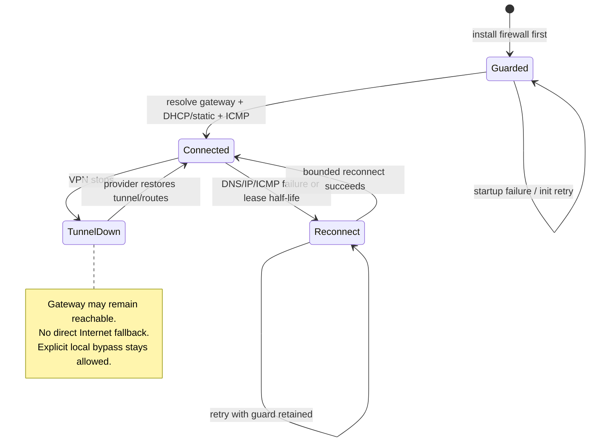

# Configuration

## Profile And Process

[The example profile](../examples/controller.json) illustrates a selected application namespace, overlay, WireGuard transport and explicit RFC1918 bypasses. These bypasses are broad security exceptions, not recommended defaults. Set `gatewayHost` to your headless-service name and `clusterDNS` to your cluster's resolvers; the supplied values are examples. Replace local image tags with immutable registry digests for deployment.

```sh
bin/podroute-controller --config examples/controller.json \
  --listen :8443 --tls-cert /path/tls.crt --tls-key /path/tls.key
# Local HTTP only: --listen 127.0.0.1:8080 --insecure-local
```

TLS 1.2+ and both readable TLS files are required unless explicit loopback-only HTTP is selected. `/mutate` accepts POST AdmissionReviews; `/healthz` is process health only. TLS files and configuration load at startup; restart to reload. No Kubernetes API client or ConfigMap RBAC is required. The controller image runs UID/GID 65532.

`helperImage`, nonempty `namespaces`, `network.gatewayHost` and nonempty `network.clusterDNS` are required. Unknown fields and unsafe ranges fail validation. System namespaces and `default` cannot be selected; use a separate, unselected gateway namespace. Mutation rejects `hostNetwork`, unknown static IDs, reserved-name collisions and partial injection. Reinvocation produces zero patch operations when helpers match exactly; conflicting helper edits are rejected.

## Webhook Integration

Configure `MutatingWebhookConfiguration` for admission v1, CREATE-only core/v1 Pods, `/mutate`, `sideEffects: None`, `failurePolicy: Fail` and `reinvocationPolicy: IfNeeded`. Supply TLS CA trust and an appropriate timeout (e.g. 5 seconds). Keep the webhook's `namespaceSelector` aligned with the profile's `namespaces`; do not use a per-Pod selector that permits selected workloads to bypass routing. Keep the gateway outside selected namespaces. Replace Pods to pick up changed helper configuration; existing Pods retain their injected JSON.

## Network Fields

| Field | Default / Meaning |
| --- | --- |
| `overlayCIDR` | `172.16.1.0/24`; IPv4 /24 only, gateway/DNS at `.1` |
| `vxlanID`, `vxlanPort` | `42`, UDP `4789`; identical across gateway/clients |
| `vpnInterface`, `vpnProtocol`, `vpnPort` | `wg0`, `udp`, `51820` |
| `vpnEndpointCIDRs` | Empty permits transport protocol/port to any IPv4 endpoint; restrict when known |
| `clientBypassCIDRs` | Empty; destinations routed directly through the client's original gateway |
| `gatewayBypassCIDRs` | Empty; destinations routed through the gateway's original gateway, with SNAT for clients |
| `clusterDNS` | Required IPv4 resolvers, reached through `eth0` |
| `clusterDomain`, `localDomains` | `cluster.local`, `[]`; conditional forwarding to cluster DNS |
| `upstreamDNS` | `1.1.1.1`, `9.9.9.9`; explicit public resolvers bound to the VPN interface |
| `dnssec` | `true`; distro-maintained root trust anchors |
| `dhcpStart` | `20`; pool ends at `.254`, `.0/.1/.255` reserved |
| `mtu` | `0`: underlay MTU minus 50 bytes; nonzero additionally caps it (set to VPN MTU, e.g. `1420`) |
| `retrySeconds` | `10`; monitor interval, range `1..300` |
| `staticClients` | Empty; optional bindings and translated inbound ports, below |

Bypasses are security exceptions, not inferred automatically. Never add `0.0.0.0/0`. The example's `172.16.0.0/12` contains the overlay: the more specific connected `/24` wins, and the client firewall blocks overlay destinations on `eth0`. Avoid more-specific bypasses inside the overlay. Public and cluster DNS must be distinct, nonrecursive unicast IPv4 addresses. Existing custom search domains/options are retained alongside namespace-local Kubernetes searches; nameservers are replaced by `.1` and policy becomes `None`.

## Runtime Contract

The gateway and injected helpers must use the same `network` JSON. The controller injects it as `PODROUTE_CONFIG`; gateway containers accept that variable or a file at `PODROUTE_CONFIG_FILE` (default `/etc/podroute/network.json`). Extract the example with `jq '.network' examples/controller.json`. JSON is data, never sourced shell code.

| Role | Ordering / Permissions |
| --- | --- |
| `podroute gateway-init` | First gateway init, before any VPN/provider process; UID 0, `NET_ADMIN`, `NET_RAW` |
| `podroute gateway-sidecar` | Alongside VPN provider; also `NET_BIND_SERVICE`, `SETGID` for dnsmasq |
| `podroute client-init` | First client init, before application inits; injected automatically |
| `podroute client-sidecar` | Native restartable init or regular sidecar; injected automatically |

All roles need writable `/run/podroute` shared within their Pod (e.g. `emptyDir`); their root filesystem can be read-only. Drop other capabilities. Client helpers use only `NET_ADMIN`/`NET_RAW`, root UID and no privilege escalation; applications remain unchanged. The gateway requires `net.ipv4.ip_forward=1`: configure it through the pod/runtime, or provide the init container writable access to that namespaced sysctl. Gateway privileges were tested separately from the privileged network fixture.

`PODROUTE_STATE_DIR` changes the state path; `PODROUTE_TRUST_ANCHORS` changes the gateway trust-anchor file. Optional `PODROUTE_IPTABLES`/`PODROUTE_IP6TABLES` select real installed backends with matching `*-restore` binaries; translation utilities are not backends. Owned `PR_*`/`PR6_*` chains are rebuilt without flushing unrelated chains. Another firewall manager must not reorder or remove their entry jumps. Disable conflicting provider firewall management when PodRoute owns the guard; concurrent policy managers have not been integrated.

Gateway discovery must return exactly one IPv4 **Pod** address, not a normal Service ClusterIP. Use one active gateway behind headless DNS and retain its `eth0` default route until gateway-init records it. A routed `eth0` with an original `default via` gateway and working VXLAN/ICMP is required. Permit explicit cluster DNS, peer UDP/VXLAN, overlay DNS/DHCP/ICMP, local bypasses and VPN transport in the future CNI/NetworkPolicy integration.



Initial DHCP is capped at 25 seconds, discovery at 4 seconds per cluster resolver and ICMP at 4 seconds. Subsequent recovery is retried indefinitely at the configured interval, with bounded individual attempts. DHCP identity survives reconnects and leases renew at half-life; renewals briefly rebuild the client tunnel. Gateway sidecar waits for the VPN interface, not a proven handshake. DNS server failure exits its container; its firewall remains installed and Kubernetes must restart it.

## Optional Static Clients

Add a binding under `network.staticClients` and annotate the workload's **Pod template** with `podroute.io/client-id: app`:

```json
{"id":"app","address":"172.16.1.10","ports":[
  {"protocol":"tcp","externalPort":18080,"targetPort":8080},
  {"protocol":"udp","externalPort":18081,"targetPort":8081}
]}
```

IDs and addresses must be unique; static hosts are `.2` through `dhcpStart - 1`. Protocol/external-port pairs must be unique across the profile. Only one live Pod may claim an ID: use a singleton workload and replacement strategy without rollout overlap. Cross-Pod claims are not coordinated or API-checked. DNAT applies only to traffic entering the VPN interface, with matching forward rules; provider-side port allocation/reachability remains external.